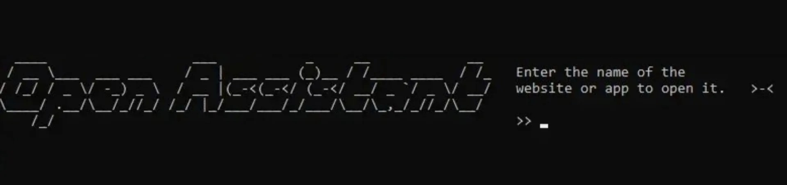

## OpenAssistant
Your command‑line utility that allows you to open websites and apps with a single command!

## How does it work?
When you open the program, you will need to enter the name of the website  
or app, and it will open.

example:  
YouTube

And then, in the browser you’ve set as default, YouTube will open.

## regarding the development:
You can safely take my code, modify it, fix bugs, and add new features.

## Files
 The entire project is divided into three different files.  

- Commands.py - The file in which user interaction takes place and which stores all the commands.
- Main_page.py - The file that stores the program’s interface, which you can freely modify.
- Main.py - The most important file that connects all the commands and the interface.

  
#### create by Marlboro ❤️
